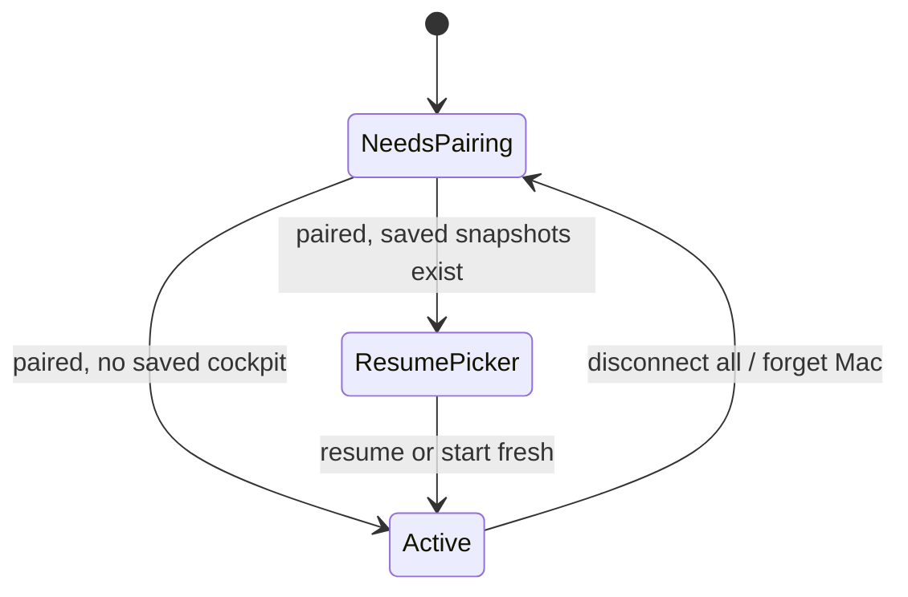
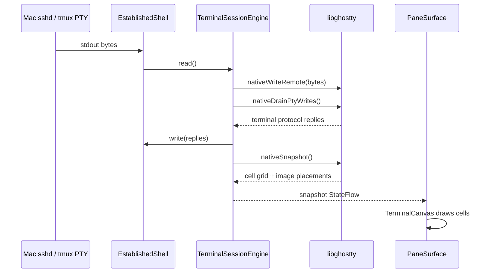

# Orb XR — Architecture

A map of the runtime components, Android ownership boundaries, and data flow
that turns verified SSH bytes into spatial terminal panes. Read
**[../VISION.md](../VISION.md)** for the product intent; this document describes
the current implementation.

## Runtime components and shared contracts

| Component | Path | Stack | Role |
|---|---|---|---|
| Headset app | `ghosttyxr/android/` | Kotlin + Compose for XR | Cockpit lifecycle, spatial panes, input, pairing, SSH, voice, relays |
| Native core | `ghosttyxr/zig-src/` | Zig | `libghosttyxr.so`: libghostty rendering + libssh2 transport behind JNI |
| Mac companion | `ghosttyxr/mac-companion/` | SwiftUI | Pairing dashboard, keyboard relay, mirror capture/encode, terminal handoff |
| Firebase backend | `firebase/` | Cloud Functions, Node 20 | Entitlement-gated voice services, onboarding access, purchase verification, RTDN |
| Compatibility contracts | `ghosttyxr/protocol/` | JSON + frozen vectors | Language-neutral wire truth shared by Kotlin and Swift adapters |

The headset is a thin client. Shells, agents, toolchains, tmux sessions, and
files live on the Mac. The Android process can disappear without destroying
host work: reconnecting attaches to the dedicated host tmux server rather than
restarting the work.

## Window-mirror compatibility seam

Mac window/display mirroring uses one versioned contract rather than two
independently documented protocols:

```text
ghosttyxr/protocol/window-mirror/
  contract-v1.json          # constants, frame table, defaults, rules
  vectors/valid.json        # frozen valid frames and expected values
  vectors/invalid.json      # malformed frames and recovery expectations
           │
           ├── Kotlin adapter  WindowMirrorProtocol.kt + WindowMirrorFrameDecoder
           └── Swift adapter   WindowMirrorProtocol.swift + WindowMirrorFrameDecoder
```

| Constant | Value | Notes |
|---|---|---|
| Relay port | `45874` | Loopback control/input reached through verified SSH direct-tcpip |
| Media port | `45876` | Direct LAN TCP video; token-authenticated, AES-GCM by default |
| Wire version | `1` | Six-byte header: version, type, big-endian payload length |
| Feature version | `5` | Hello JSON `version`; older peers are rejected |
| Max frame | `8 MiB` | Oversized, wrong-version, and unknown frames reset the decoder |

Both platform test suites load the same fixtures. Change the contract, both
adapters, and both test suites together.

## Android Gradle graph

`ghosttyxr/android/` contains one Gradle module: `:app`. The former phone
companion/shared modules are gone and must not be recreated.

## Android package map

```text
com.ghosttyxr.app
├─ MainActivity              Activity lifecycle, controller graph, permissions, key dispatch
├─ GhosttyXRApplication      Firebase init + App Check provider selection
├─ ImmersiveEnvironment      Focus-mode environment catalog and application
├─ billing/                  Entitlement mirror, Play Billing, purchase/onboarding clients
├─ intro/                    Two-step setup flow + five-step live cockpit coach
├─ qr/                       Pairing payload, CameraX scanner, pending/debug routing
├─ ui/
│  ├─ GhosttyXRApp           Root cockpit composable
│  ├─ chrome/                Gxr* design-system primitives
│  ├─ pairing/               Startup/reconnect scanner surface
│  ├─ pane/                  Terminal and window-mirror panes
│  ├─ panel/                 Settings, themes, voice, Pro controls
│  ├─ pointer/               Symbiosis XR cursor/router
│  └─ resume/                Durable-session resume/termination picker
├─ wiring/                   Android/XR construction for voice and pet surfaces
├─ util/                     GxrLog
└─ terminal/
   ├─ session/               Cockpit lifecycle, engines, snapshots, tmux, resume, CWD
   ├─ ssh/                   Verified host access, QR pin check, RSA keygen, pairing persistence
   ├─ input/                 Keyboard/controller/scrollback/on-screen input
   ├─ voice/                 Cloud STT, Gemini commands, pet speech
   ├─ hands/                 Palm-up pet + prayer-lock gesture machines
   ├─ spatial/               Spatial grid, pane layout persistence, 2D fallback
   ├─ theme/                 Ghostty themes + GhosttyTokens
   ├─ hostkeyboard/          Verified Mac keyboard relay
   ├─ windowmirror/          control channel, direct-TCP media client, decoder
   ├─ handoff/               Attach-only transfer of live tmux sessions to the Mac
   └─ settings/              Prefs-backed user settings
```

`MainActivity` is the Android coordination boundary: it constructs the
controller graph, owns permission launchers and app-wide key dispatch, and
switches between first-flight setup and the cockpit. Business logic remains in
injected controllers, lifecycle types, and pure state machines so it can be
tested without launching XR.

## Cockpit ownership

`CockpitLifecycle` is the public production seam for terminal orchestration.
The UI and input layers receive this capability rather than a repository or raw
engine list.



`DefaultCockpitLifecycle` owns:

- one to six `TerminalSessionEngine` instances;
- stable `PaneId` identities, focus, add/remove/disconnect operations;
- fresh-vs-resume startup and `CockpitState` publication;
- snapshot capture through the `SnapshotPersistence` port;
- host-session termination, agent-state probes, and new-pane CWD probes;
- the single shared `VerifiedHostAccess` used by terminals, probes, relays, and
  terminal handoff.

Each engine is exposed to UI code as a narrow `CockpitPane`. The concrete
engine stays internal to the lifecycle. Durable snapshots retain host tmux
session keys, pane layout/size, focus, Full Space state, and agent resume data.

## New-pane CWD routing

Host tmux is authoritative. Before connecting a new pane,
`DefaultCockpitLifecycle.addPane()` asks `PaneCwdProbe` for the focused/source
session's `#{pane_current_path}` over a short-lived verified shell. The
normalized absolute path is passed as a concrete, safely quoted
`tmux new-session -c` argument. Engine-side OSC 7 metadata is only a fallback
when the host probe fails. See
**[cwd-routing-handoff.md](cwd-routing-handoff.md)** before modifying this path.

## Terminal data flow

Each `TerminalSessionEngine` owns one libghostty surface and one established
shell. Engine work runs on a dedicated `terminal-pane-<id>` dispatcher; the
established channel also serializes transport calls because neither libghostty
nor libssh2 is safe for unsynchronized concurrent use.



`VerifiedHostAccess` owns the transport factory and the complete
handshake → host-key verification → authentication → channel-open sequence.
Consumers receive only an `EstablishedShell` or `EstablishedTunnel`, never the
raw `SshTransport`.

The engine targets a 16 ms snapshot floor and backs idle polling off to 160 ms.
Input wakes an idle loop immediately. A 20-second keepalive detects half-open
connections; failures use jittered exponential reconnect, interruptible when
network connectivity returns. Whole-line voice/agent submissions pass through
the 120 ms command-quiescence gate so terminal-protocol replies cannot splice
into user commands.

## Conventions

- **Inject Android and network edges.** Lifecycle/controller logic takes small
  interfaces or lambdas; construction belongs in `MainActivity` or `wiring/`.
- **Use the cockpit capability seam.** UI and input code consume
  `CockpitLifecycle` / `CockpitPane`; do not expose engines or recreate a
  repository layer.
- **Use one SSH authority.** Terminal shells, short-lived probes, relays, and
  handoff share `CockpitLifecycle.hostAccess` so host verification cannot drift.
- **Use settings stores only for user preferences.** Add prefs-backed flows to
  `GhosttySettingsStore`; SSH private material belongs in `PairedMacStore`.
  AI provider keys never belong in the APK.
- **Use `GhosttyTokens` and `ui/chrome/*`.** libghostty paints terminal glyphs;
  Compose owns chrome only.
- **Keep spatial and flat paths.** Gate on spatial capabilities and maintain a
  Home Space / Compose-test fallback.
- **Centralize test tags.** Production and instrumented tests both reference
  constants from `ui/UiTestTags.kt`.

## Verification layers

- JVM tests (`:app:testDebugUnitTest`) cover cockpit lifecycle, reconnect,
  tmux/bootstrap/CWD parsing, input, onboarding, billing, voice controllers,
  hand gestures, snapshots, and protocol codecs.
- Instrumented tests (`:app:connectedDebugAndroidTest`) cover the native bridge,
  engine integration, encrypted pairing storage/provisioning, the flat app E2E,
  and spatial semantics. Run them only on the official arm64 Android XR AVD;
  see `ghosttyxr/android/TESTING.md`.
