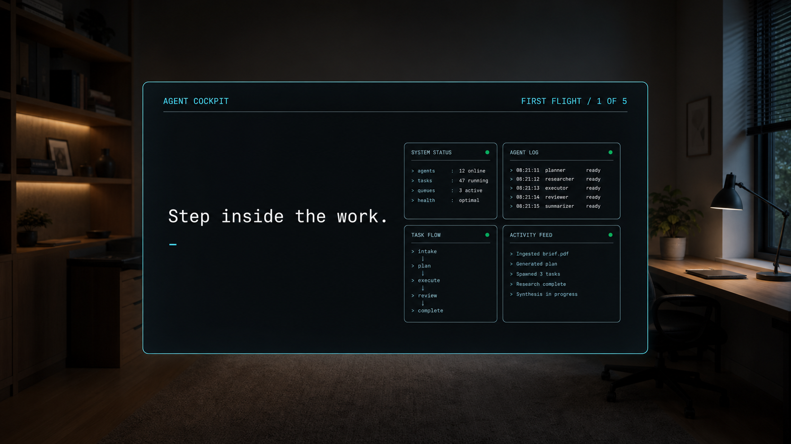
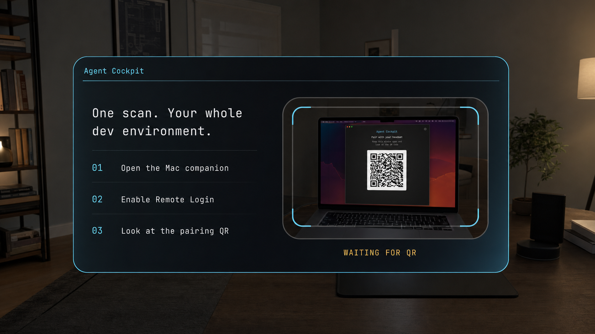
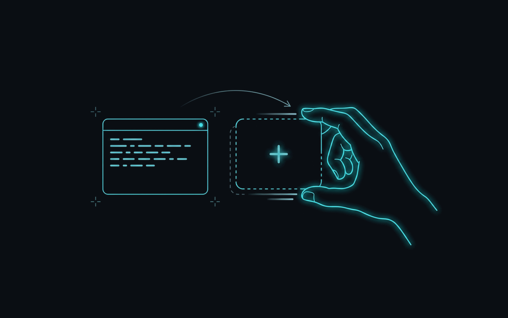
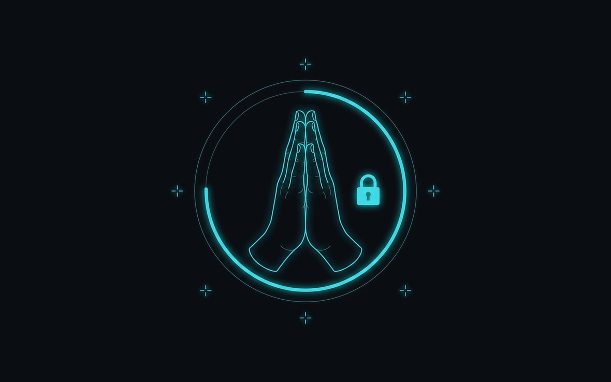

# First-flight onboarding

Orb XR's first run has two phases:

1. a two-step full-screen setup flow that explains the product and performs
   real Mac pairing; then
2. a five-step coach embedded in the live cockpit that teaches the core
   spawn/lock/voice loop.

The headset-view images in this folder are generated design-review mockups, not
device captures. The source of truth is `intro/OnboardingFlow.kt`,
`intro/OnboardingCoach.kt`, and the shipping resources under `res/`.

## Phase 1: setup

### 1. Product promise

The opening page explains the outcome before asking for setup work: one
developer can keep several host-side coding agents visible, each in a real
terminal pane, without hiding work behind tabs. Its four-pane constellation is
illustrative and does not mutate the live cockpit.

Actions:

- `Continue` advances to pairing.
- `Voice on/off` controls bundled narration.
- `Skip tour` completes onboarding immediately and opens the normal app state;
  it does not show the live coach.

### 2. Pair the Mac

The pairing page links to `https://ghosttyxr-headset.web.app` for the Mac
companion and embeds the production `QrScannerScreen`. A scanned payload uses
the same activity-owned route as normal pairing:

1. parse and validate the `ssh://` payload;
2. verify the supplied host fingerprint when present;
3. provision/reuse the headset SSH key;
4. persist the paired Mac; and
5. start the tmux-backed cockpit through `CockpitLifecycle`.

The page observes `PairedMacStore` and live `SessionState`s. A connected pane
replaces the scanner with `MAC CONNECTED`; the primary action then enters the
live cockpit coach. `Pair later` completes onboarding and returns to the normal
pairing surface without showing the coach.

The setup flow is a stable `1024dp × 720dp` `SpatialPanel` in Full Space and a
responsive flat layout in Home Space/tests. Wide layouts use two columns;
narrow layouts stack the same regions. Actions use centralized test tags from
`UiTestTags.kt`.

## Phase 2: live cockpit coach

The coach is passed to `AdaptiveTerminalPanel` as `coachContent`, so the user
sees and manipulates the real cockpit while learning it. Every step has a
continue/action button; unavailable hand tracking never blocks completion.

### 1. First terminal

The coach identifies the visible pane as a real Mac terminal and reinforces
the persistence contract: shells and agents run on the Mac and survive headset
disconnects.

### 2. Spawn a pane

`Spawn a pane` calls the real `CockpitLifecycle.addPane`, inheriting from the
focused source pane and focusing the new result. The coach advances only when
the add succeeds, so the lesson cannot pretend a pane exists at the cap.

### 3. Prayer hold: lock panels

Holding both palms together toggles the session-only `layoutLocked` flag via
`PrayerToggleMachine` and `HandMenuController`. Locking freezes panes exactly
where they are; it does not snap the grid back to defaults. `Alt+1` through
`Alt+6` still changes focus.

`GestureCoachMachine` watches the real hoisted lock flag, so a genuine gesture
or the equivalent Settings → Layout → Lock panels switch counts as practice.
When hand tracking is unavailable, the coach shows the illustration and points
to Settings instead.

### 4. Palm-up voice orb

The non-pointing hand held palm-up summons the orb. The mic opens after the
reveal; flipping palm-down submits the turn and dismisses the orb. The coach
observes `HandMenuController.isMenuVisible` and awards practice only after a
fresh summon-then-dismiss round trip. Without hand tracking, it explains the
`Alt+Space` keyboard fallback.

Voice AI is temporarily available during first flight. The gesture and
terminal cockpit remain available after onboarding; ongoing AI voice access is
part of Pro.

### 5. Ready

`Finish first flight` persists the existing `intro_played` preference, hides
the coach, and ends temporary onboarding access. Pro remains optional in
Settings; finishing onboarding never launches or requires a purchase.

## Temporary onboarding access

First flight uses a bounded, server-owned entitlement rather than a client-side
gate:

- On first-run startup, `MainActivity` signs in, marks completion as pending,
  and calls `beginOnboardingAccess` through `OnboardingAccessClient`.
- The function grants at most one 24-hour entitlement with
  `source: "onboarding"`. It does not override an active paid entitlement and
  cannot be claimed again after completion.
- Completing or skipping either phase calls `completeOnboardingAccess`. An
  onboarding-sourced entitlement returns to Free; a paid Play entitlement is
  never revoked.
- `onboarding_access_completion_pending` remains set until the completion call
  succeeds. A later launch retries it, preventing a network failure at the end
  of setup from turning temporary access into a permanent grant.

The backend still checks entitlement on metered voice requests. See
[`../monetization.md`](../monetization.md).

## Bundled narration

Narration is prerecorded and never synthesized at runtime:

- setup: `onboarding_welcome.ogg`, `onboarding_pair.ogg`;
- coach: one `coach_*.ogg` clip per coach step; and
- gesture acknowledgments: `coach_lock_done.ogg`, `coach_pet_done.ogg`.

`OnboardingNarrationPlayer` uses `MediaPlayer` with assistant audio routing.
Changing pages replaces the current clip; muting, pausing, completing, or
destroying the activity stops/releases playback. The assets are regenerated at
development time with `ghosttyxr/tools/generate_narration.sh`, which synthesizes
locally with MLX-Audio and needs no API key or network access. That script's
`CLIPS` block is the source of truth for the spoken lines; keep it in sync with
the visible copy in `OnboardingFlow.kt`/`OnboardingCoach.kt`.

## State ownership and tests

- `MainActivity` owns visibility of setup/coach, narration playback, pending QR
  consumption, and begin/complete onboarding-access calls.
- `OnboardingFlow` owns only its current setup page and narration toggle.
- `OnboardingCoach` owns its current coach step, narration toggle, and one-shot
  acknowledgment latches.
- `CockpitLifecycle`, `PairedMacStore`, `EntitlementStore`, and
  `BillingController` remain the production sources of truth.
- `OnboardingStepTest` covers the two-step setup sequence.
- `OnboardingCoachStepTest` covers per-step narration and illustration mapping.
- `GestureCoachMachineTest` covers real lock and summon/dismiss progress.
- `OnboardingAccessClientTest` and Firebase entitlement tests cover the
  temporary grant contract.
