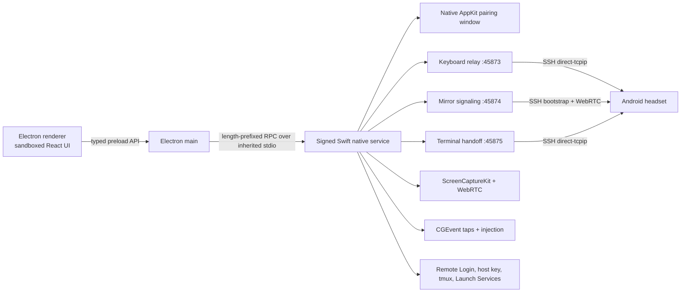
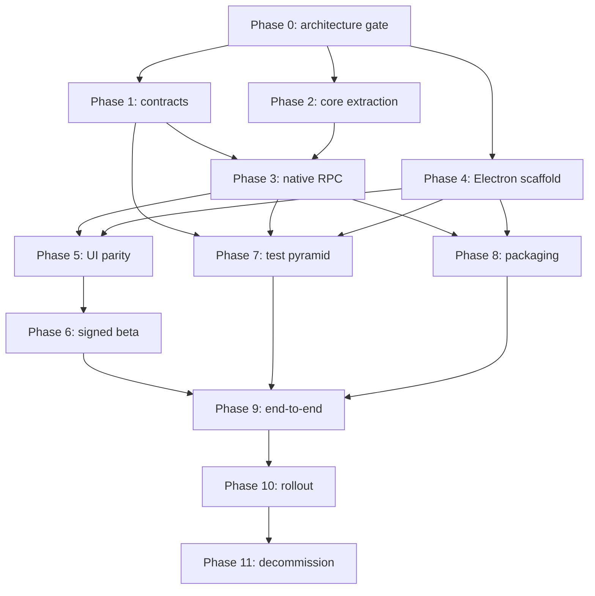

# Electron migration specification for the GhosttyXR Mac companion

**Status:** Proposed implementation specification  
**Date:** 2026-07-16  
**Target:** Replace the SwiftUI presentation layer with Electron while retaining a native macOS data plane  
**Repository default branch:** `main`  
**Current app bundle identifier:** `dev.ghosttyxr.companion`  
**Current minimum OS:** macOS 14  

## 1. Executive summary

The Mac companion should migrate to a hybrid Electron architecture, not a full
JavaScript rewrite.

Electron should own:

- the dashboard, onboarding, Settings, menus, and window lifecycle;
- presentation state and accessibility semantics;
- application updates;
- non-secret preferences;
- renderer crash recovery and local diagnostics;
- coordination of a separately signed native service.

A retained Swift native service should own:

- the credential-entry and QR pairing surface for compatibility pairing v1;
- the three loopback relay listeners on ports `45873`, `45874`, and `45875`;
- ScreenCaptureKit capture and the current WebRTC H.264 pipeline;
- Accessibility event taps, pointer ownership, and input injection;
- window and display enumeration;
- Remote Login and host-key probes;
- tmux discovery and terminal handoff;
- launch-at-login integration if Electron's API cannot preserve exact behavior;
- all raw keyboard, pointer, video, SDP, ICE, password, and SSH-sensitive data.

The Electron renderer must never sit on a real-time, privileged, or credential
data path. It receives bounded, redacted state snapshots and sends a narrow set
of schema-validated commands through a context-isolated preload. It never
receives the Mac password, raw pairing URL, or QR pixels. Renderer reloads or
crashes must not interrupt pairing, relays, keyboard capture, terminal handoff,
or an active mirror.

This architecture is more work than wrapping the current app in a web view, but
it preserves the product's low-latency host services, macOS permission behavior,
and Android protocol compatibility. It also contains Electron's larger attack
surface behind a small IPC capability boundary.

The migration is expected to require approximately 25 engineer-weeks before
contingency, or 30 to 32 engineer-weeks with a 25 percent risk reserve. A
three-engineer team with part-time QA, release, Android, design, and security
support should plan for 10 to 14 elapsed weeks plus a 4 to 6 week production
soak before deleting the SwiftUI frontend.

## 2. Decision summary

| Decision | Specification |
|---|---|
| Product shape | Electron UI plus retained Swift native data plane |
| Renderer framework | React, TypeScript, Vite, Redux Toolkit |
| Packaging | Electron Forge, ASAR, signed ZIP, optional DMG |
| Native boundary | Separately signed Swift child process over inherited stdio |
| Native addon | Avoid by default; use Node-API only as a TCC fallback |
| Compatibility pairing v1 | Native AppKit secure entry and QR window; no credential material in Electron |
| Pairing v2 | Required before broad stable rollout unless a security exception is approved |
| App Sandbox | Do not enable the macOS App Sandbox |
| Chromium sandbox | Enable for every renderer |
| Supported architecture at parity launch | Apple Silicon `arm64` |
| Intel support | Separate follow-up product decision after architecture closure |
| Bundle identity | Preserve `dev.ghosttyxr.companion`, product name, executable name, and Developer ID team |
| Protocols | Preserve existing ports, frame formats, versions, defaults, and failure behavior |
| Update source | Existing GitHub Releases infrastructure with separate stable and beta manifests |
| Telemetry | Local-first; remote upload off by default and explicitly consented |
| Rollout | Signed beta, staged stable promotion, rollback by higher-version emergency build |
| SwiftUI deletion | Only after two stable Electron releases and 6 to 8 weeks of soak |

At planning time, Electron `43.1.1` is the current stable baseline found during
research. Implementation must pin an exact patched Electron release that has
at least 90 days of expected support runway at stable-release time. Renovate
must keep the app on a supported line rather than treating `43.1.1` as
permanent.

## 3. Motivation

The companion has grown beyond a pairing QR utility. It is now a persistent
host control plane for:

- pairing and SSH readiness;
- tmux setup;
- keyboard forwarding;
- window and display mirroring;
- remote input and Symbiosis pointer ownership;
- terminal handoff from the headset to Mac terminal windows;
- launch-at-login and app-lifetime services.

Electron is attractive because it allows faster iteration on a dashboard-style
interface, a larger pool of UI contributors, mature end-to-end testing, and
shared web design tooling. The migration is justified only if it does not move
latency-sensitive or TCC-sensitive behavior into the renderer.

The product remains an orchestration surface. The Mac is the source of truth,
host agents continue running independently of the dashboard, and terminal
fidelity remains the responsibility of the headset's native terminal stack.

## 4. Goals

### 4.1 Product goals

1. Preserve every current companion workflow and failure state except the
   explicitly approved removal of unsafe or misleading behavior documented in
   this specification.
2. Make dashboard and Settings iteration faster and more testable.
3. Keep host services alive after the main window closes.
4. Keep mirror and input latency within the current native envelope.
5. Preserve pairing compatibility with the current and previous supported
   Android clients.
6. Add a production-grade update path after the Electron cutover.
7. Improve release reproducibility, security, and rollback readiness.
8. Preserve macOS permission grants across an in-place signed upgrade whenever
   macOS permits it.

### 4.2 Engineering goals

1. Establish an explicit, versioned boundary between UI and native services.
2. Keep raw media and input inside the native process.
3. Make renderer state disposable and recoverable from an authoritative
   snapshot.
4. Make protocol compatibility executable through shared golden vectors.
5. Make release artifacts traceable to a tested immutable commit.
6. Prevent a compromised renderer from gaining arbitrary shell, file, network,
   input-capture, or screen-capture capabilities.

## 5. Non-goals

- Rewriting ScreenCaptureKit, CoreGraphics event taps, or WebRTC in JavaScript.
- Moving window mirroring through a Chromium renderer.
- Changing the Android window-mirror protocol during UI migration.
- Changing the pairing URL or authentication model in the parity milestone.
- Adding cloud relay, TURN, or external ICE servers.
- Enabling Remote Login without an explicit user action.
- Renaming the bundle identifier or product.
- Adding Intel support as part of the initial parity release.
- Replacing `tmux -L gxr`.
- Replacing the headset's libghostty terminal renderer.
- Uploading telemetry, crash dumps, screenshots, terminal output, or user input
  by default.

Pairing v2 and relay authentication are a release workstream, not an excuse to
put the compatibility password into Electron. Compatibility pairing v1 stays
inside a native AppKit surface. Pairing v2 requires a separately versioned
Android and Mac protocol project and is required before broad stable rollout
unless a written security exception documents the remaining exposure, owner,
expiry date, and compensating controls.

## 6. Current system inventory

### 6.1 Measured scope

The research inventory found, as of this specification:

- 37 Swift source files;
- approximately 7,528 Swift source lines;
- five XCTest files;
- approximately 743 XCTest lines and 35 tests;
- a signed, notarized, stapled Apple Silicon app;
- an application bundle of roughly 34 MB and a ZIP of roughly 16 MB;
- a universal WebRTC framework inside an otherwise `arm64` application.

These counts are planning evidence, not future acceptance criteria.

### 6.2 Current app identity and lifecycle

The current companion is:

- a regular Dock app with `LSUIElement=NO`;
- bundle identifier `dev.ghosttyxr.companion`;
- executable `GhosttyXRCompanion`;
- product name `GhosttyXR Companion`;
- macOS 14 or newer;
- Developer ID signed with hardened runtime;
- notarized and stapled for release.

Closing the main window does not quit. Clicking the Dock icon restores the main
window. The application exposes a normal Settings window through Command-Comma.
Relay and mirror services are application-lifetime objects.

Electron must preserve all of these behaviors.

### 6.3 Current pairing behavior

The current implementation:

- ranks active IPv4 interfaces, preferring the expected Mac interfaces;
- allows explicit interface selection;
- probes Remote Login with `systemsetup`, then a loopback TCP probe;
- opens the macOS Sharing settings instead of enabling sshd automatically;
- reads the real SSH host fingerprint when available;
- omits `fp` when the host key is absent or unreadable;
- builds `ssh://<user>@<IPv4>:22?token=<value>&fp=<fingerprint>`;
- rotates a random token with a 30-second lifetime when no password is present;
- uses the entered Mac login password as the token with a 24-hour display
  lifetime after the onboarding credential step.

The final point is important. Existing documentation describes the QR value as
an ephemeral token, but the current implementation places the Mac login
password in the QR URL after onboarding. Android submits `token` literally as
the SSH password. The random 30-second pre-credential token is not a usable SSH
credential and must not be presented as a working pairing code. Compatibility
pairing must retain the password in native memory while the user expects QR
rescans to work because pairing v1 has no provisioning acknowledgement. Clear
it only on explicit user action, onboarding reset, or app exit. Never persist
it or expose it to Electron, logs, telemetry, crash metadata, or diagnostics.

The current host fingerprint is derived from
`/etc/ssh/ssh_host_ecdsa_key.pub`, not Ed25519, because the Android libssh2
bridge currently negotiates ECDSA first. The migration must preserve this
behavior until the native SSH client changes in a coordinated Android release.

### 6.4 Current host protocols

| Capability | Port | Transport | Version and limits |
|---|---:|---|---|
| Keyboard relay | `45873` | Loopback TCP reached through verified SSH forwarding | Versioned line JSON, current version 1 |
| Window mirror | `45874` | Loopback TCP for SSH-authenticated signaling, WebRTC for media/data | Wire version 1, feature version 4, 6-byte header, 8 MiB maximum frame |
| Terminal handoff | `45875` | Loopback TCP reached through verified SSH forwarding | Line JSON version 1, 64 KiB maximum frame |

The ports are bound to IPv4 loopback. They are not LAN listeners. The Android
client reaches them through the already verified SSH connection.

### 6.5 Current native dependencies

The companion directly uses:

- AppKit and SwiftUI;
- ApplicationServices and CoreGraphics;
- ScreenCaptureKit;
- CoreMedia and CoreVideo;
- Network.framework;
- WebRTC.framework;
- CryptoKit;
- ServiceManagement;
- Launch Services and NSWorkspace;
- `Process` for bounded system commands.

The following behavior is high-risk to reproduce in JavaScript and remains
native under this specification:

- active `CGEvent.tapCreate` keyboard and pointer taps;
- fail-open key suppression and emergency-release handling;
- `CGEvent` input injection;
- `AXIsProcessTrusted` checks and prompts;
- ScreenCaptureKit source enumeration and capture;
- NV12 frame delivery to WebRTC;
- WebRTC H.264 sender setup and adaptive resolution;
- pointer ownership sequencing;
- loopback Network.framework listeners;
- tmux and terminal opening behavior;
- signing and TCC-sensitive launch-at-login behavior.

## 7. Compatibility invariants

The migration is not complete unless all of the following remain true.

### 7.1 Pairing

- Scheme remains `ssh`.
- Port remains `22`.
- Query key remains `token`.
- `fp` remains optional.
- URL escaping remains equivalent to Foundation `URLComponents`.
- Missing host key omits `fp`; no placeholder or guessed fingerprint is used.
- Network detection failures remain visible.
- Remote Login is never enabled without user action.
- The user can choose among real detected interfaces.

### 7.2 Keyboard relay

- Port remains `45873`.
- Listener remains loopback-only.
- Existing hello, ready, ping, pong, and event semantics remain compatible.
- Key order and monotonic sequence behavior remain intact.
- Local key suppression occurs only while capture is explicitly armed or
  Symbiosis requires it.
- Any failure to forward must fail open, returning input to the Mac.
- Existing emergency-stop and pointer-toggle chords continue to work.
- Injected events remain identifiable so the app does not recapture its own
  input.

### 7.3 Window mirror

- Port remains `45874`.
- Wire version remains `1`.
- Feature version remains `4`.
- Header remains six bytes with big-endian payload length.
- Maximum frame remains 8 MiB.
- Existing frame IDs, defaults, invalid-frame reset behavior, and shared
  vectors remain authoritative.
- Media remains WebRTC H.264 with DTLS-SRTP.
- Capture remains ScreenCaptureKit NV12.
- Signaling remains SSH-authenticated and loopback-bound.
- Control data remains reliable and ordered.
- High-rate pointer motion remains allowed to use the existing low-latency
  unordered channel.
- No public STUN, TURN, or cloud signaling is introduced.

### 7.4 Terminal handoff

- Port remains `45875`.
- Protocol version remains `1`.
- Maximum line remains 64 KiB.
- Session names remain restricted to `[A-Za-z0-9_-]{1,64}`.
- All requested sessions are verified before opening any terminal window.
- Every tmux invocation uses `tmux -L gxr`.
- Handoff attaches to existing sessions and never kills them.
- A failure leaves headset panes intact.
- Launch Services remains the terminal-opening mechanism.
- The undocumented AppleScript Terminal fallback is removed at cutover unless
  a separately reviewed Automation permission flow, usage description,
  entitlement policy, and physical-Mac test matrix are approved.

### 7.5 Lifecycle and settings

- Closing the dashboard does not quit the app.
- Reopening from the Dock restores the dashboard.
- Command-Comma opens Settings.
- Launch-at-login remains visible and failure-aware.
- Existing preference keys are migrated without destructive reset.
- Onboarding is not marked complete until the existing readiness contract is
  met.
- No installer or update path runs `tccutil reset`.

### 7.6 Compatibility versus hardening rule

The parity release preserves current wire-visible behavior. A stricter hello
order, new authentication requirement, pane-count rejection, replay cache,
timeout, rate limit, queue policy, or disconnect rule is allowed only when one
of these is true:

1. repository evidence proves the rule is already enforced by both peers;
2. shared frozen vectors define it and current plus previous Android binaries
   pass unchanged;
3. the protocol version or negotiated feature version is bumped in a
   coordinated Android and Mac release.

Phase 1 must freeze exact values for:

- keyboard 16 KiB frames, 256 pending sends, connection replacement/refusal,
  queue overflow, and liveness behavior;
- mirror 8 MiB frames, decoder reset, bootstrap ordering, and ping behavior;
- handoff 64 KiB lines, six-session cockpit ceiling, request ordering, and
  duplicate handling;
- all idle, handshake, request, retry, burst, and disconnect timeouts.

Do not turn desirable hardening into an accidental incompatible change.

## 8. Target architecture



### 8.1 Trust zones

| Zone | Trust | Allowed responsibilities |
|---|---|---|
| Renderer | Least trusted | Render state, collect user intent, local ephemeral UI state |
| Preload | Narrow capability bridge | Expose frozen typed methods and subscriptions only |
| Main | Trusted coordinator | Windows, lifecycle, update policy, preference migration, native supervision |
| Native service | Privileged data plane | Secure pairing surface, TCC APIs, capture, input, relays, tmux, host probes |
| Android peer | Authenticated through SSH and protocol handshakes | Existing headset workflows |

The renderer cannot:

- call Node APIs;
- access arbitrary files;
- spawn processes;
- open arbitrary URLs;
- enumerate windows;
- receive raw key or pointer events;
- receive video frames;
- receive SDP or ICE;
- read the raw pairing URL, QR pixels, or password;
- bind listeners;
- invoke arbitrary native methods.

### 8.2 Failure containment

- Renderer crash: main keeps native services alive, recreates the renderer, and
  sends the latest full snapshot.
- Renderer reload: no relay or capture restart.
- Main crash: inherited RPC closes; native service releases event taps,
  returns pointer ownership to Mac, stops mirror, closes listeners, and exits.
- Native service crash: main immediately marks native features unavailable,
  ensures UI controls are disabled, performs a bounded restart, and surfaces
  the failure.
- Native restart loop: after three failures in five minutes, stop restarting
  and require explicit user action.
- Update installation: disarm keyboard, return pointer ownership, stop mirror,
  await native shutdown acknowledgement, then install.

## 9. Proposed repository layout

```text
ghosttyxr/mac-companion/
  electron/
    package.json
    package-lock.json
    forge.config.ts
    vite.main.config.ts
    vite.preload.config.ts
    vite.renderer.config.ts
    tsconfig.json
    src/
      main/
        bootstrap/
        lifecycle/
        windows/
        ipc/
        native/
        state/
        pairing/
        settings/
        updates/
        observability/
      preload/
        companion-api.ts
      renderer/
        app/
        features/
          onboarding/
          pairing/
          devices/
          settings/
          diagnostics/
        components/
        state/
        styles/
    packages/
      contracts/
        ipc.ts
        native-rpc.ts
        snapshot.ts
        errors.ts
        redaction.ts
    test/
      unit/
      integration/
      electron/
      packaged/
  native/
    CompanionCore/
    GxrNativeService/
    GxrNativeServiceTests/
  GhosttyXR-Companion/
    ...legacy SwiftUI app during migration...
```

The existing SwiftUI tree stays buildable until the cutover. Native extraction
must first allow the legacy app to consume `CompanionCore` in-process. The same
core is then linked by `GxrNativeService`. This proves extraction parity before
Electron becomes the stable frontend.

Use npm workspaces and commit `package-lock.json`. Pin the build-time Node LTS
and package manager through `.nvmrc` or `.node-version` plus the
`packageManager` field. CI uses `npm ci`; no floating installs are allowed.

## 10. Electron process design

### 10.1 Main process

The main process is the application authority for:

- single-instance locking;
- application ready and shutdown sequencing;
- dashboard and Settings windows;
- Dock reopen behavior;
- menu construction;
- native child supervision;
- the authoritative `CompanionSnapshot`;
- renderer registration and snapshot delivery;
- non-secret preference storage and migration;
- updater state and quiescence policy;
- structured logging and local support bundles;
- exact allowlists for external URLs and System Settings destinations.

The main process must call `app.enableSandbox()` before `ready`.

It must create renderer windows with:

```ts
{
  nodeIntegration: false,
  contextIsolation: true,
  sandbox: true,
  webSecurity: true,
  webviewTag: false,
  allowRunningInsecureContent: false,
  preload: absoluteSignedPreloadPath
}
```

Production DevTools are disabled unless a signed internal diagnostic build is
used. Navigation, new-window creation, permission requests, downloads, and
unexpected origins are denied by default.

### 10.2 Preload

Preload exports one frozen `window.companion` object through
`contextBridge.exposeInMainWorld`.

Example surface:

```ts
interface CompanionApi {
  getSnapshot(): Promise<CompanionSnapshot>;
  subscribe(
    callback: (snapshot: CompanionSnapshot) => void
  ): () => void;
  execute(command: CompanionCommand): Promise<CommandResult>;
  getAppInfo(): Promise<PublicAppInfo>;
}
```

Preload must not expose:

- `ipcRenderer`;
- Electron event objects;
- channel names chosen by the renderer;
- generic `send`, `invoke`, filesystem, shell, or process methods;
- arbitrary URL opening;
- native RPC primitives.

Every command and response is parsed with shared runtime schemas before it
crosses a trust boundary.

### 10.3 Renderer

The renderer uses React and TypeScript. Redux Toolkit stores:

- the latest immutable native/application snapshot;
- the latest revision number;
- local routing and disclosure state;
- form state that is safe for the renderer;
- command pending/error status.

Redux is a disposable read model, not the system of record. The main process
remains authoritative. If the renderer detects a revision gap, it requests a
full snapshot rather than replaying native events.

The compatibility credential flow is an exceptional native surface:

Compatibility pairing v1 is not implemented in the renderer. The renderer can
only request that main ask native service to open its signed AppKit pairing
window. That native window owns:

- `NSSecureTextField` credential and confirmation entry;
- native Secure Event Input behavior when verified safe on supported macOS;
- password lifetime and explicit clearing;
- URL construction;
- QR rendering;
- full-screen QR;
- copy/export confirmation;
- pairing-v1 warnings and expiry display.

Electron receives only coarse state such as `pairingWindowOpen`,
`credentialPresent`, `pairingCodeAvailable`, and redacted endpoint labels. A
compromised renderer can request that the native window open, but it cannot
read or submit credentials, retrieve the QR, trigger copy/export, or approve a
privileged action without a native user gesture.

### 10.4 Content loading

Register a custom standard secure application scheme before app ready. Load
only bundled assets through that scheme. The protocol handler maps allowlisted
paths into the packaged ASAR and rejects traversal, query-driven file access,
and unknown MIME types.

Register only these privileges:

```ts
{
  standard: true,
  secure: true,
  bypassCSP: false,
  allowServiceWorkers: false,
  supportFetchAPI: false,
  corsEnabled: false
}
```

Any later privilege increase requires a security review and packaged test.

Do not load remote UI, remote scripts, CDN assets, web fonts, or arbitrary
HTML.

Use a nonpersistent Electron session partition. Register both
`setPermissionRequestHandler` and `setPermissionCheckHandler` to deny all
renderer permissions. Deny downloads, authentication prompts, file choosers,
device selection, desktop capture, media capture, drag-and-drop navigation,
`will-navigate`, and `setWindowOpenHandler` by default. Each window receives a
different least-privilege preload capability set; the Settings window cannot
invoke operational keyboard, mirror, handoff, or pairing commands unless a
specific flow requires them.

Minimum CSP:

```text
default-src 'none';
script-src 'self';
style-src 'self';
img-src 'self' data:;
font-src 'self';
connect-src 'none';
media-src 'none';
object-src 'none';
frame-src 'none';
base-uri 'none';
form-action 'none';
```

If development tooling needs broader directives, they must be development-only
and absent from packaged builds.

## 11. Native service design

### 11.1 Default topology

`GxrNativeService` is a separately signed Swift executable embedded in the
application bundle. Electron main spawns it by an absolute bundle resource
path without a shell. The child receives:

- inherited stdin for commands;
- inherited stdout for responses and events;
- stderr for structured native logs;
- a minimal sanitized environment;
- app build and protocol compatibility metadata;
- no bearer credential in command-line arguments.

Before spawn, main must:

- resolve the helper through a canonical no-symlink bundle path;
- open or validate it without following symlinks;
- verify its bundle location, Team ID, signing identifier, designated
  requirement, hardened-runtime state, and expected hash or build manifest;
- reject writable or externally substituted code paths;
- pass only explicitly allowlisted file descriptors with close-on-exec set on
  everything else.

Before opening TCC resources or binding a port, native service must validate
its parent PID with Security.framework and require the expected Electron main
designated requirement, Team ID, bundle ancestry, and protocol build
compatibility. Failure exits before any privileged side effect.

The process exits when:

- stdin reaches EOF;
- it receives a valid shutdown command;
- its parent is no longer alive;
- startup identity validation fails.

It must not become an independent launch daemon.

### 11.2 TCC architecture gate

TCC identity and permission continuity are the first implementation gate.

Prototype all of the following in signed, notarized test builds on macOS 14 and
every other supported macOS major:

1. Clean install of legacy Swift app.
2. Grant Accessibility and Screen Recording.
3. Upgrade in-place to the Electron app with native child.
4. Confirm whether grants are retained.
5. Confirm which binary appears in System Settings.
6. Revoke and regrant Accessibility.
7. Revoke and regrant Screen Recording.
8. Exercise Local Network permission if the packaged topology triggers it.
9. Exercise Automation permission only if any Apple Events path remains.
10. Verify launch-at-login state through clean install, upgrade, disable,
    re-enable, rollback, and reinstall.
11. Confirm keyboard capture, injection, and ScreenCaptureKit work from the
   child without weakening library validation.

The separately signed child remains the preferred architecture only if this
gate passes with documented expected principals, prompts, grant retention,
revocation recovery, and user-visible remediation. Testing only an upgrade
cannot satisfy the gate.

If macOS attributes required permissions in a way that breaks acceptable
upgrade continuity, the approved fallback is a minimal Node-API bridge loaded
only in Electron main for the affected TCC APIs. The bridge must:

- use Node-API rather than direct V8 APIs;
- expose the same `NativeBridge` interface;
- keep raw data out of renderer IPC;
- preserve an out-of-process media and relay service where possible;
- be rebuilt and tested against every Electron update;
- never require `com.apple.security.cs.disable-library-validation` unless a
  separate security review approves it.

This fallback accepts greater main-process crash risk and is not chosen for
convenience.

### 11.3 CompanionCore extraction

Refactor current native code into domain modules with injected dependencies:

- `PairingCore`
- `NetworkInterfaceCore`
- `RemoteLoginCore`
- `HostFingerprintCore`
- `TmuxCore`
- `KeyboardRelayCore`
- `MirrorCore`
- `TerminalHandoffCore`
- `PermissionCore`
- `LoginItemCore`
- `DiagnosticsCore`

The extraction must not change protocol behavior. The legacy SwiftUI app must
run through these modules before Electron depends on them.

### 11.4 Native RPC

Use inherited stdio, not a listening socket, for the first implementation.
This reduces local attack surface and ties child lifetime to the parent.

Each frame:

```text
uint32 big-endian byte length
UTF-8 JSON payload
```

Rules:

- protocol version is explicit;
- maximum control frame is 1 MiB;
- deadlines are durations measured against a monotonic clock, never wall time;
- unknown message type is a protocol error;
- malformed or oversized frame terminates the child connection;
- every command has `requestId`, `deadlineMs`, and optional `idempotencyKey`;
- every response echoes `requestId`;
- every helper start creates a random `instanceEpoch`;
- events carry `instanceEpoch` and a monotonically increasing `revision`;
- logs use stderr, never the protocol stream;
- high-rate status is coalesced;
- command and event queues have fixed byte and item limits;
- stdout and stderr readers are always drained concurrently;
- low-priority state is coalesced before critical lifecycle or error events;
- request cancellation is explicit and best-effort;
- timed-out requests cannot later mutate state unless their command contract is
  declared non-cancellable and idempotent;
- replay is permitted only for commands with an idempotency key and cached
  outcome in the same `instanceEpoch`;
- raw video, keys, pointer deltas, SDP, and ICE never use this channel.

Envelope:

```ts
type NativeRpcEnvelope =
  | {
      v: 1;
      type: "hello";
      helperVersion: string;
      appBuild: string;
      instanceEpoch: string;
      capabilities: string[];
    }
  | {
      v: 1;
      type: "request";
      requestId: string;
      deadlineMs: number;
      idempotencyKey?: string;
      command: NativeCommand;
    }
  | {
      v: 1;
      type: "response";
      requestId: string;
      ok: boolean;
      result?: unknown;
      error?: NativeError;
    }
  | {
      v: 1;
      type: "snapshot";
      instanceEpoch: string;
      revision: number;
      snapshot: NativeSnapshot;
    }
  | {
      v: 1;
      type: "event";
      instanceEpoch: string;
      revision: number;
      event: NativeEvent;
    };
```

Handshake must verify:

- matching RPC major version;
- compatible helper/application build;
- expected capabilities;
- no unexpected downgrade;
- a bounded startup timeout.

### 11.5 Native command allowlist

Initial commands:

- refresh network interfaces;
- choose interface;
- refresh Remote Login state;
- open exact Sharing settings destination;
- open or close the native pairing window;
- refresh host fingerprint;
- refresh tmux state;
- begin or cancel a confirmed tmux installation workflow;
- arm or disarm keyboard relay;
- acknowledge permission prompt;
- enumerate mirror sources;
- select mirror source;
- start or stop mirror;
- change mirror bitrate within the existing range;
- toggle or force-return pointer ownership;
- set launch-at-login;
- request redacted diagnostics;
- quiesce for update;
- shut down.

There is no generic process execution command.

Privileged or destructive commands require a fresh native confirmation bound
to the exact command, target, and expiry. Process execution uses absolute
paths, argv arrays, sanitized environment, bounded stdout/stderr, a process
group, timeout, and cancellation of the full process tree.

Native confirmation policy:

- opening the native pairing window requires no privilege confirmation, but
  entering, revealing, copying, exporting, or clearing credential material is
  possible only inside that native window;
- arming keyboard capture from an inactive state requires a native confirmation
  and always leaves a visible native status/control;
- starting a mirror requires native source selection or confirmation;
- enabling remote input or transferring pointer ownership requires native
  confirmation for the active target;
- installing tmux, changing launch-at-login, quiescing for update while a
  feature is active, and any Automation path require native confirmation;
- stop, emergency release, force-return pointer, and close actions never
  require confirmation.

Confirmations cannot be synthesized through RPC and expire when the relevant
feature stops, target changes, helper restarts, or permission is revoked.

The migration removes the current generated Homebrew installer that executes
remote `curl` output. If Homebrew is absent, open only the exact HTTPS
`https://brew.sh/` page and show manual instructions. `brew install tmux` may
remain as an explicit, natively confirmed argv-based action against a verified
Homebrew executable.

## 12. Authoritative state model

Main owns a revisioned `CompanionSnapshot`.

Suggested shape:

```ts
interface CompanionSnapshot {
  schemaVersion: 1;
  instanceEpoch: string;
  revision: number;
  app: {
    version: string;
    build: string;
    channel: "internal" | "beta" | "stable";
    nativeStatus: "starting" | "ready" | "degraded" | "failed";
  };
  onboarding: {
    complete: boolean;
    step: "welcome" | "macReady" | "credentials" | "pair";
  };
  pairing: {
    interfaces: PublicNetworkInterface[];
    selectedInterfaceName?: string;
    remoteLogin: PublicRemoteLoginState;
    tmux: PublicTmuxState;
    hostFingerprintAvailable: boolean;
    endpointLabel?: string;
    nativePairingWindowOpen: boolean;
    credentialPresent: boolean;
    pairingCodeAvailable: boolean;
    expiresAt?: string;
    error?: PublicError;
  };
  keyboard: PublicKeyboardRelayState;
  mirror: PublicMirrorState;
  handoff: PublicHandoffState;
  permissions: PublicPermissionState;
  settings: PublicSettings;
  updates: PublicUpdateState;
}
```

No snapshot field contains:

- password or token;
- raw pairing URL or QR image;
- IP address in support logs;
- key codes or text;
- session names or titles;
- window titles or application names in telemetry;
- SDP or ICE;
- frame pixels.

UI can display endpoint and window labels during the live session, but
observability redaction must treat them as sensitive.

## 13. Feature specifications

### 13.1 Onboarding and pairing

The Electron onboarding flow preserves the four current conceptual steps:

1. Welcome.
2. Mac readiness.
3. Credentials.
4. Pairing.

Readiness requires:

- a real selected network interface;
- Remote Login on;
- tmux installed.

Credential readiness requires a non-empty password and matching confirmation.
The migration may improve explanatory copy, but it must not change protocol
semantics in the parity release.

Credential entry, URL generation, QR rendering, full-screen display, copy, and
export occur only in the native AppKit pairing window. Copy and export require
an explicit native user action and a warning that the code contains the Mac
login password under pairing v1. Electron receives only redacted state.

Random token generation must use a cryptographically secure source. Timers use
an injected monotonic clock for expiration decisions and wall time only for
display.

The native pairing-v1 state machine is:

1. No credential: no scannable QR is shown; the random placeholder is not
   advertised as usable.
2. User enters and confirms a password in the native secure window.
3. Native memory holds the password and renders the compatibility QR.
4. The displayed expiry can rotate presentation metadata, but the password is
   retained because v1 has no provisioning acknowledgement.
5. Explicit Clear, onboarding reset, or app exit zeroes native mutable buffers
   where practical and destroys the pairing view.

Pairing v2 replaces this state with a one-time capability exchange and explicit
acknowledgement.

### 13.2 Remote Login

Native service preserves:

- authoritative `systemsetup -getremotelogin` when available;
- bounded loopback TCP probe fallback;
- visible unknown/error states;
- explicit open of the macOS Sharing pane;
- no privilege escalation;
- no automatic sshd enablement.

All subprocess execution uses an absolute executable path, argv arrays, timeout,
bounded output, and no shell.

### 13.3 Host fingerprint

Native service reads the current ECDSA host public key and computes the current
SSH SHA-256 fingerprint format. Missing or unreadable key is a visible absence,
not an error replaced by fake data.

Changing to Ed25519 requires a coordinated Android SSH negotiation change and
is outside parity scope.

### 13.4 Keyboard relay

Keyboard relay remains wholly native.

Requirements:

- active event tap only while armed or required by Symbiosis;
- explicit Accessibility status;
- visible permission guidance;
- maximum queue of 256 events;
- monotonic sequence numbers;
- bounded write buffering;
- no raw keys in logs or RPC;
- fail-open on disconnect, queue overflow, watchdog expiry, or native failure;
- emergency stop always handled locally;
- injected-event marker preserved;
- pointer ownership toggle shared consistently with Symbiosis;
- app deactivation behavior matches current semantics.

Renderer only sends arm/disarm intent and receives coarse state.

### 13.5 Window and display mirror

Mirror remains wholly native.

Requirements:

- source enumeration excludes the companion itself;
- explicit window or display selection;
- Screen Recording permission is visible and revocable;
- capture uses ScreenCaptureKit and NV12;
- hardware H.264 behavior remains equivalent;
- the existing resolution ladder and encoder restart strategy remain intact;
- latest-frame coalescing prevents unbounded queues;
- bitrate remains bounded to the existing supported range;
- current stats remain locally observable;
- remote input requires active mirror, approved target, Accessibility, valid
  coordinate ranges, valid actions, and rate limiting;
- pointer return on stop, crash, permission loss, or update;
- no frame crosses Electron IPC.

### 13.6 Terminal handoff

Handoff remains wholly native.

The Electron cutover intentionally removes the current AppleScript fallback
because it introduces an undeclared Apple Events Automation permission path.
If Launch Services cannot open the `.command` handler, native service returns a
visible error and opens no additional session. Reintroducing a Terminal.app
fallback requires an explicit product and security decision, correct
`NSAppleEventsUsageDescription`, any required entitlements, user-facing
permission guidance, and revoke/regrant tests.

Additional hardening during extraction:

- preserve current ordering in parity, then require hello before
  `open_sessions` only under a frozen compatible rule or a bumped version;
- reject duplicate session names only under the same compatibility rule;
- enforce the current cockpit maximum of six sessions only after shared
  vectors and current/previous Android binary tests prove compatibility;
- require non-empty `req_id`;
- add bounded request-outcome idempotence only in a negotiated protocol version;
- create scratch directory with mode `0700`;
- reject symlinks and use no-follow file creation;
- use unpredictable file names;
- keep generated command files mode `0700`;
- robustly quote the tmux path;
- schedule bounded cleanup;
- never log session names outside local debug logs;
- acknowledge success only after windows have been opened.

### 13.7 Launch at login

Preferred implementation:

1. Main reads `app.getLoginItemSettings()`.
2. Main calls `app.setLoginItemSettings()` for normal Electron integration.
3. Packaged tests verify system state and error behavior.

If this cannot preserve current `SMAppService` state or surface failures
adequately, native `LoginItemCore` remains authoritative. Electron must not
show a successful toggle until the system state confirms it.

### 13.8 Preferences and rollback migration

Stable migration must read the existing CFPreferences domain for
`dev.ghosttyxr.companion` before writing any Electron preference file.

Exact legacy mapping:

| Legacy key | Meaning | Electron/native destination |
|---|---|---|
| `dev.ghosttyxr.companion.onboarding.v2.completed` | Onboarding completion | Preserve in CFPreferences and mirror into schema-versioned main state |
| `windowMirrorBitrateMbps` | Mirror ceiling, clamped to 8 through 50 | Preserve in CFPreferences; native MirrorCore remains authoritative |
| `SMAppService.mainApp.status` | Launch-at-login system state | Reconcile from the operating system, never infer from a copied boolean |

Migration is idempotent:

1. Read legacy CFPreferences and system login-item state.
2. Validate and clamp values.
3. Write Electron schema-versioned preferences atomically with mode `0600`.
4. Record migration version and source checksum.
5. Re-read both stores and verify semantic equality.
6. Only then mark migration complete.

On failure, retain legacy data, surface the error, and use safe defaults without
overwriting the source. Beta uses a separate bundle ID and user-data directory
and may import a copy, never mutate stable preferences or login-item state.

For at least two stable Electron releases, use dual-read, Electron-write
behavior: Electron prefers validated new state but can recover from legacy
keys. Do not delete legacy keys until decommission. A rollback reinstall of the
last Swift app must recover onboarding, bitrate, and login-item state without a
reset.

### 13.9 Dashboard and Settings

The dashboard preserves:

- pairing hero and QR;
- real status and error banners;
- Devices sections for Mac Keyboard and Window Mirror;
- large tile-style actions rather than thin full-width buttons;
- a resizable main window;
- current dark, translucent visual direction;
- keyboard navigation and screen-reader labels;
- reduced-motion support;
- sufficient contrast without relying on translucency.

Settings preserves:

- General;
- Pairing diagnostics;
- Mirror bitrate;
- launch at login;
- development-only credential diagnostics only in explicitly internal builds.

Production UI must not display or copy the Mac password after entry.

## 14. Security specification

### 14.1 Threat model

Primary threats:

1. Renderer compromise through an Electron or web dependency vulnerability.
2. IPC privilege escalation from renderer to main or native service.
3. Local process connection to loopback relay ports.
4. Leakage of the password-bearing QR.
5. Malicious or malformed Android protocol frames.
6. Supply-chain compromise in npm, GitHub Actions, Electron, or WebRTC.
7. Update-feed or artifact substitution.
8. Native helper replacement or unexpected binary loading.
9. Sensitive crash dumps or diagnostics.
10. Stuck keyboard suppression or stranded XR pointer ownership.

### 14.2 Electron hardening

Mandatory:

- no remote content;
- `nodeIntegration=false`;
- `contextIsolation=true`;
- renderer `sandbox=true`;
- `webSecurity=true`;
- `webviewTag=false`;
- strict CSP;
- deny navigation and new windows;
- deny permissions and downloads by default;
- exact allowlist for external URLs;
- validate `event.senderFrame`, top-level `webContents`, and app origin;
- runtime schemas on every IPC request and response;
- deadlines, payload bounds, and typed errors;
- production DevTools disabled;
- no Electron `remote` module;
- no generic shell, filesystem, or network bridge;
- no dynamic `require` from writable locations.

Electron fuses:

- `RunAsNode`: off;
- `EnableNodeOptionsEnvironmentVariable`: off;
- `EnableNodeCliInspectArguments`: off;
- `EmbeddedAsarIntegrityValidation`: on;
- `OnlyLoadAppFromAsar`: on;
- `GrantFileProtocolExtraPrivileges`: off;
- `CookieEncryption`: on where supported.

CI verifies fuse state from the packaged binary.

### 14.3 Local relay security

Parity release preserves loopback plus SSH-tunnel authentication. Add:

- strict hello ordering;
- bounded framing;
- one active client where the current protocol expects one;
- idle timeout and ping/pong liveness;
- explicit rejection of unsupported versions;
- rate limits for remote input;
- disconnect on malformed or oversized frames;
- no listener fallback to wildcard or LAN addresses;
- fail-visible bind errors.

Pairing v2 should add an app-level random capability, nonce, and HMAC handshake
to all three relays. Loopback binding is not sufficient against another process
running as the same Mac user. This is a follow-up protocol version, not an
unreviewed migration change.

### 14.4 Secrets

Never persist or remotely report:

- Mac password;
- pairing token;
- QR contents;
- SSH private or public credentials;
- raw host fingerprint;
- IP address or username;
- key text or key codes;
- terminal session names or titles;
- window or app titles;
- pixels;
- SDP or ICE;
- clipboard;
- terminal output;
- arbitrary file paths.

If a durable relay capability is introduced later, store it with Keychain in
native code or Electron `safeStorage`, with explicit migration and rotation.

### 14.5 Dependency and supply-chain controls

- exact Electron version;
- committed `package-lock.json`;
- `npm ci` in CI;
- no lifecycle scripts from unexpected dependencies;
- dependency allowlist for native modules;
- Dependabot or Renovate with grouped Electron patch upgrades;
- weekly supported-major review;
- SHA-pinned GitHub Actions;
- one release inventory covering npm packages, Electron/Chromium/Node,
  SwiftPM packages, WebRTC.framework, native frameworks, build tools, and
  GitHub Actions;
- SBOMs in CycloneDX or SPDX format for JavaScript and native components;
- third-party license notice artifact covering npm, Swift, WebRTC, and bundled
  binaries;
- OSV scanning plus npm, Swift, Electron, WebRTC, and Action advisory review;
- CodeQL or equivalent static analysis;
- secret scanning;
- artifact checksums and GitHub artifact attestations where available;
- release from a protected environment.

## 15. macOS signing, entitlements, and TCC

### 15.1 Identity preservation

Stable cutover preserves:

- bundle ID `dev.ghosttyxr.companion`;
- executable and display name;
- Developer ID team;
- install location `/Applications/GhosttyXRCompanion.app`;
- usage-description strings;
- macOS 14 minimum;
- regular Dock-app identity.

TCC continuity depends on code identity and macOS policy, not bundle ID alone.
The signed upgrade matrix is a release blocker.

### 15.2 Entitlement policy

Use least privilege per binary.

Expected Electron renderer/helper entitlements may include JIT support required
by Electron. Do not apply Electron entitlements to the Swift service unless
required.

Prohibited without separate security approval:

- disable library validation;
- allow DYLD environment variables;
- broad Apple Events automation;
- App Sandbox exceptions used as a substitute for correct architecture;
- unsigned executable memory when the chosen Electron version does not require
  it.

The app remains outside the macOS App Sandbox because its core workflows depend
on global event taps, input injection, capture, and terminal integration. This
does not change the requirement to enable Chromium renderer sandboxing.

### 15.3 Signing order

Define exact bundle locations before implementation:

```text
GhosttyXRCompanion.app/
  Contents/MacOS/GhosttyXRCompanion
  Contents/Resources/app.asar
  Contents/Frameworks/GxrNativeService
  Contents/Frameworks/WebRTC.framework
  Contents/Frameworks/GhosttyXRCompanion Helper*.app
```

The final path may place the native service in `Contents/Helpers`, but the
choice must be consistent with Electron Forge, code signing, runtime lookup,
and Security.framework requirement checks. CI rejects unexpected copies.

For each executable and framework, the release manifest records path,
architectures, rpaths, install names, signing identifier, Team ID, designated
requirement, entitlements, and expected parent bundle.

Release packaging must sign inside-out, with the outer application signed last:

1. Swift native service.
2. WebRTC and embedded native frameworks.
3. Electron helper applications.
4. Main Electron application.
5. Outer app bundle.

Then:

1. verify `codesign --verify --deep --strict`;
2. inspect designated requirements;
3. submit to notary service;
4. staple;
5. validate the staple;
6. run Gatekeeper assessment;
7. verify bundle ID, versions, architectures, entitlements, rpaths, fuses, and
   ASAR integrity.

No release script resets TCC.

### 15.4 Privacy strings

Audit usage descriptions against actual features instead of copying stale text.
The current Screen Recording string says only a chosen window is captured, but
the product also supports full-display Symbiosis. The replacement string must
plainly disclose chosen-window or chosen-display capture.

Retain Local Network and input-related strings only when the packaged app
actually triggers the corresponding macOS permission. Add
`NSAppleEventsUsageDescription` only if the separately reviewed Automation path
is retained. Packaged tests compare every privacy string to the enabled feature
set.

## 16. Update design

### 16.1 Channels

- `internal`: developer and QA builds;
- `beta`: signed canary builds;
- `stable`: public releases.

Use dedicated version tags such as:

- `companion-v1.2.3`;
- `companion-beta-v1.2.3`.

Do not continue the globally ambiguous `v*` namespace for new companion
releases.

### 16.2 Feed

Use Electron's macOS `autoUpdater`, Squirrel.Mac, and Electron Forge Maker ZIP.
Publish one persistent HTTPS feed per channel and architecture:

```text
https://<update-host>/companion/<channel>/<arch>/RELEASES.json
```

`channel` is `internal`, `beta`, or `stable`; `arch` is initially `arm64`.
Forge generates the Squirrel-compatible `RELEASES.json`; application code does
not invent a parallel schema. A companion release metadata file may add minimum
OS, checksum, notes, and rollout policy, but it cannot replace the Squirrel
feed expected by `autoUpdater`.

Publication order is immutable artifact, checksum/SBOM/notarization evidence,
release metadata, then `RELEASES.json` last. Use cache-busting or short cache
headers for the manifest and long immutable caching for versioned ZIPs. A
client that observes a manifest must always be able to fetch its referenced
artifact.

Version ordering uses SemVer for `CFBundleShortVersionString` and a strictly
monotonic integer `CFBundleVersion` derived from the protected build pipeline.
Channel promotion reuses the exact signed artifact and never rebuilds it.
Before install, verify expected bundle ID, Team ID, designated requirement,
architecture, minimum OS, version monotonicity, checksum, notarization/staple,
and code signature.

The updater:

- checks after services are ready;
- downloads in the background;
- treats both explicit `quitAndInstall` and a normal quit with a downloaded
  update as installation paths;
- intercepts quit, determines whether an update is pending, and never exits
  into installation while keyboard capture, mirror, pointer ownership, or
  handoff is active unless the user explicitly confirms;
- quiesces native service and receives a shutdown acknowledgement before the
  update-capable quit proceeds;
- preserves tmux sessions and all host agents;
- reports exact update state and errors;
- does not silently downgrade.

Rollback is a higher-version emergency build containing the last-known-good
code. Retain at least the previous two notarized artifacts and manifests.

Rollout denominators must not depend on opt-in product telemetry. Use
privacy-preserving update-feed request counts, release download counts, signed
beta cohort membership, support reports, and optional consenting health
telemetry as separate signals. State the confidence and blind spots for each
promotion decision.

### 16.3 Legacy-to-Electron transition

Existing releases have no updater. Recommended default:

- publish a final Swift release with a prominent signed migration notice and
  verified download link;
- continue offering a manually installable notarized Electron ZIP;
- preserve preferences and TCC identity for in-place replacement;
- do not add Sparkle solely for a one-time bridge unless installed-base data
  justifies the extra release surface.

After Electron adoption, all future versions use the Electron updater.

## 17. Observability and privacy

### 17.1 Local logs

Use:

- `app.setAppLogsPath()` only to choose/create the log directory;
- an explicit logger that writes size-rotated structured JSON lines with file
  mode `0600`;
- structured native stderr captured by main;
- correlation IDs across UI command, main action, native request, and result;
- bounded retention.

Log:

- app lifecycle;
- native service lifecycle and exit codes;
- state transitions;
- protocol error classes;
- queue depth and overflow;
- mirror capture/encode rates;
- bitrate, loss, and RTT aggregates;
- update outcomes;
- permission state transitions.

Redact the sensitive fields listed in section 14.4.

### 17.2 Crashes

- Start and configure Electron Crashpad locally before renderer or native
  service startup.
- Observe `render-process-gone`, unresponsive renderer, and native exits.
- Keep Electron Crashpad dumps local by default.
- Do not upload dumps automatically because process memory may contain secrets.
- Offer an explicit, reviewed diagnostic submission flow later.
- Symbolicate native and Electron releases.
- Include a local support-bundle generator that excludes memory dumps by
  default and is testable for redaction. Do not claim that a memory dump can be
  reliably redacted.

### 17.3 Optional telemetry

Remote telemetry is explicit opt-in. Allowed fields:

- app version and build;
- architecture;
- coarse OS version;
- update outcome;
- helper exit category;
- protocol error category;
- coarse feature-state transition;
- aggregate performance counters.

No identifiers or sensitive content are allowed.

## 18. Testing strategy

### 18.1 TypeScript unit tests

Use Vitest for:

- runtime schemas;
- snapshot reducers and revision-gap recovery;
- command allowlists;
- pairing URL compatibility;
- TTL and clock behavior;
- interface ranking;
- redaction;
- preference migrations;
- update quiescence;
- native supervision and restart budgets;
- CSP and origin allowlists;
- typed error mapping.

### 18.2 Swift native tests

Retain and expand XCTest for:

- window-mirror contract vectors;
- resolution ladder;
- pairing and fingerprint behavior;
- native secure pairing-window state and proof that credential and QR material
  never appears in RPC, Electron IPC, logs, snapshots, or support bundles;
- keyboard protocol and key translation;
- terminal-handoff protocol;
- request idempotence;
- scratch-file hardening;
- RPC framing and handshake;
- helper shutdown and parent-loss behavior;
- permission state mapping;
- launch-at-login adapter.

### 18.3 Android peer tests

Run relevant Kotlin JVM tests for:

- pairing parser;
- keyboard relay;
- terminal handoff;
- window mirror;
- compatibility with current and previous native-service protocol versions.

### 18.4 Shared golden vectors

Window mirror already has an authoritative shared contract. Add shared
contracts and valid/invalid vectors for:

- pairing URL;
- keyboard relay;
- terminal handoff;
- native RPC.

Every Swift, TypeScript, and Kotlin adapter must consume the same applicable
vectors for:

- ports and versions;
- maximum frame sizes;
- defaults;
- fragmentation and multiple frames per read;
- unknown types;
- bad versions;
- oversized-frame reset;
- optional fingerprint;
- URL escaping;
- session-name alphabet;
- key modifier mapping;
- legacy-version negotiation.

### 18.5 Main/native integration tests

Use a fake native service and a real test native service for:

- startup handshake;
- full snapshot;
- incremental event;
- revision gap;
- command timeout;
- malformed response;
- helper crash and bounded restart;
- queue overflow;
- port contention;
- permission revocation;
- network changes;
- missing sshd;
- missing host key;
- preference migration;
- update quiescence.

### 18.6 Electron UI tests

Use Playwright's Electron support against a fake native bridge:

- onboarding paths;
- dashboard status and errors;
- Settings;
- close without quit;
- Dock-style reopen through main lifecycle hooks;
- single-instance behavior;
- native pairing-window status and expiry labels;
- keyboard and mirror controls;
- disabled states during native failure;
- renderer crash and snapshot restoration;
- preload capability limits;
- navigation and popup denial;
- accessibility roles, labels, keyboard navigation, and reduced motion.

### 18.7 Packaged-app tests

On a signed test artifact:

- verify Info.plist identity and usage strings;
- verify architecture closure;
- verify nested signatures;
- verify hardened runtime and entitlements;
- verify ASAR and fuse state;
- launch the packaged app;
- ensure no unexpected network listener exists;
- start and stop native service;
- simulate native restart;
- verify Gatekeeper and notarization staple;
- install an update from the test feed;
- verify settings migration;
- verify no development rpaths or writable code paths.

### 18.8 Physical Mac and headset matrix

Hosted CI cannot replace this matrix.

Test on:

- oldest supported macOS;
- current macOS;
- clean installation;
- in-place legacy-to-Electron upgrade;
- retained and revoked TCC permissions;
- current Android client;
- previous supported Android client;
- real Apple Silicon Mac;
- real headset.

Flows:

- QR pair and SSH;
- Remote Login off/on;
- keyboard capture and emergency release;
- window mirror;
- display mirror;
- remote input;
- Symbiosis pointer handoff and return;
- terminal handoff to the same `gxr` sessions;
- Wi-Fi loss and recovery;
- headset reconnect;
- close window while services run;
- launch at login;
- updater interruption;
- rollback build install.

## 19. Performance budgets

Phase 0 records a reproducible baseline protocol:

- exact Mac model, chip, RAM, power mode, macOS build, display setup, and
  network topology;
- exact headset build and Android app build;
- fixed window and display sources;
- fixed 1080p and native-resolution motion workloads;
- fixed keyboard event script and relay destination;
- cold start after reboot and warm start cases;
- at least 30 runs for startup and control latency;
- at least 10 five-minute runs for idle and mirror metrics;
- p50, p95, confidence interval, outlier policy, and raw local result artifact.

Compare Swift and Electron on the same hardware, OS, network, capture source,
and headset. First record stable Swift baselines, then gate:

| Metric | Budget |
|---|---|
| Cold start to native services ready | p95 under 3 seconds and no more than 20 percent slower than baseline |
| QR/token rotation drift | under 250 ms |
| Main-to-native control RPC | p95 under 50 ms |
| Native state propagation to renderer | under 250 ms |
| Idle CPU | p95 under 1 percent |
| Idle RSS | under 250 MB |
| Keyboard forwarding overhead | under 2 ms over native baseline |
| Mirror capture-to-send latency | no more than 5 percent regression |
| Mirror dropped frames, CPU, energy | no more than 5 percent regression |
| Renderer interaction response | under 100 ms |
| Arm64 compressed artifact | under 100 MB |
| Arm64 installed size | under 250 MB |
| Optional universal compressed artifact | under 160 MB |
| Optional universal installed size | under 450 MB |

The native data plane should make the keyboard and mirror budgets achievable.
Budgets must be tightened if baseline measurements show substantially better
headroom.

## 20. CI and release engineering

### 20.1 Pull request CI

Create a least-privilege `mac-electron-ci.yml`:

1. Checkout with SHA-pinned action and no persisted credentials.
2. Select pinned Node LTS.
3. `npm ci`.
4. Lockfile integrity and dependency policy check.
5. Format check.
6. ESLint.
7. TypeScript typecheck.
8. Vitest.
9. Build renderer/main/preload.
10. Build and run Swift tests.
11. Run Android compatibility JVM tests when shared contracts change.
12. Run Playwright Electron tests with fake native service.
13. Package unsigned app for structure smoke checks.
14. Upload bounded test reports only.

### 20.2 Release workflow

Create a protected `mac-electron-release.yml`:

1. Checkout the exact tested commit.
2. Restore no untrusted binary cache for signing steps.
3. Install with `npm ci`.
4. Re-run release-critical tests.
5. Build native service.
6. Build Electron app.
7. Flip and verify fuses.
8. Sign nested components and outer app.
9. Notarize and staple.
10. Verify signature, Gatekeeper, staple, identity, versions, architectures,
    entitlements, rpaths, ASAR, and fuses.
11. Generate ZIP, optional DMG, checksums, SBOM, licenses, and channel manifest.
12. Attest artifacts.
13. Publish all channel assets atomically.
14. Promote the immutable artifact between channels without rebuilding.

Release must depend on successful CI for the same commit. The current
independent release workflow can publish even when the separate test workflow
fails; that gap must be closed.

### 20.3 Path filters during migration

Separate:

- legacy SwiftUI paths;
- shared native-core paths;
- Electron paths;
- shared protocol paths.

Electron-only changes must not emit a legacy Swift release. Shared native or
protocol changes must test both frontends until cutover.

## 21. Migration plan

### Phase 0: architecture and baseline

Deliver:

- product ADR explaining how Electron increases orchestration-bandwidth
  iteration without moving terminal or real-time host primitives out of their
  native paths, tied directly to `VISION.md`;
- approved feature inventory;
- approved threat model;
- stable performance baseline;
- TCC signed-upgrade spike;
- decision on helper versus Node-API fallback;
- decision on arm64-only versus Intel follow-up;
- decision on final Swift migration notice.

Estimate: 1 engineer-week plus permission-lab time.

### Phase 1: authoritative contracts

Deliver:

- pairing contract and vectors;
- keyboard contract and vectors;
- terminal-handoff contract and vectors;
- native RPC contract and vectors;
- exact compatibility tests in Swift, Kotlin, and TypeScript.

Estimate: 2 engineer-weeks.

### Phase 2: CompanionCore extraction

Deliver:

- native domain modules;
- injected platform seams;
- legacy SwiftUI app using CompanionCore;
- no behavior change;
- expanded XCTest.

Estimate: 3 engineer-weeks.

### Phase 3: native service and RPC

Deliver:

- signed child executable;
- RPC handshake and schemas;
- authoritative snapshots;
- command allowlist;
- crash/restart handling;
- owner lock for fixed ports;
- parent-loss shutdown;
- structured redacted logs.

Estimate: 3 engineer-weeks.

### Phase 4: secure Electron scaffold

Deliver:

- Forge, React, TypeScript, Vite;
- main/preload/renderer boundaries;
- sandbox and CSP;
- fuses;
- fake native bridge;
- lifecycle and window shell;
- initial CI.

Estimate: 2 engineer-weeks.

### Phase 5: UI parity

Deliver:

- onboarding;
- dashboard;
- native pairing-window integration, QR, and full-screen QR;
- Devices controls;
- Settings;
- errors and permissions;
- accessibility;
- close/reopen and single-instance parity.

Estimate: 3 engineer-weeks.

### Phase 6: signed beta and migration

Deliver:

- final Swift release with the shared atomic owner lock;
- side-by-side beta identity `dev.ghosttyxr.companion.electron.beta`;
- separate beta user-data directory;
- defined read-only shadow interface, otherwise a tested require-stable-to-quit
  flow;
- atomic service owner lock;
- preference migration;
- stable-identity signed upgrade rehearsal;
- TCC verification.

Estimate: 1.5 engineer-weeks.

### Phase 7: test pyramid and performance

Deliver:

- unit, integration, Playwright, packaged, and protocol tests;
- physical-lab runbook;
- performance gates;
- support-bundle redaction tests.

Estimate: 3 engineer-weeks.

### Phase 8: packaging and updates

Deliver:

- least-privilege signing profiles;
- notarized ZIP and optional DMG;
- update manifests and channels;
- update quiescence;
- SBOM and licenses;
- protected release workflow;
- rollback build procedure.

Estimate: 3 engineer-weeks.

### Phase 9: end-to-end validation

Deliver:

- real Mac and headset matrix;
- current and previous Android compatibility;
- clean install and upgrade;
- permission revocation;
- network and process-failure tests;
- performance report.

Estimate: 2 engineer-weeks.

### Phase 10: rollout

Deliver:

- internal cohort;
- beta cohort;
- staged stable promotion;
- freeze and rollback thresholds;
- support monitoring;
- 4 to 6 week soak.

Estimate: 1 engineer-week plus soak.

### Phase 11: SwiftUI decommission

Deliver:

- delete SwiftUI presentation only;
- retain CompanionCore and native service;
- remove legacy CI and release paths;
- preserve last notarized Swift artifact and rollback runbook;
- update architecture documentation.

Estimate: 1 engineer-week.

## 22. Dependency DAG



## 23. Rollout strategy

### 23.1 Development modes

Use local/build-time flags, not a remote kill switch:

- `GXR_FRONTEND=swift|electron`;
- `GXR_NATIVE_MODE=inprocess|helper`;
- `GXR_SERVICE_MODE=shadow|active`;
- `GXR_UPDATE_CHANNEL=internal|beta|stable`.

Production stable builds compile a single approved configuration.

### 23.2 Side-by-side beta

The beta uses a separate bundle ID and user-data location. It cannot own fixed
ports while stable is active.

Before side-by-side beta begins, ship a final Swift release that participates
in the same owner-lock protocol. Native ownership uses a mode-`0600`,
symlink-resistant lock in a mode-`0700` app-support directory and records
process identity, bundle ID, build, and random epoch. The owner must acquire the
lock and bind all three ports as one transaction. If any bind fails, it closes
every acquired listener, releases the lock, and reports failure. It never owns
a partial service set.

A second process:

- enters shadow/read-only mode only through a defined local state interface;
- otherwise reports the active owner;
- never steals keyboard capture;
- never starts a second mirror;
- never silently changes ports.

The shadow interface is a separate versioned, read-only, mode-`0600` Unix
socket owned by the active companion. It exposes only the same redacted
`CompanionSnapshot`, authenticates the peer's code requirement and user ID,
allows one bounded subscriber, and has no command surface. If this interface is
not implemented and tested, beta must require stable to quit rather than claim
shadow mode.

Stable-identity permission continuity is tested with signed lab builds, not by
running two identical stable apps concurrently.

### 23.3 Promotion

Suggested cohorts:

1. Internal.
2. Small beta cohort.
3. Broad beta cohort.
4. Stable 5 percent.
5. Stable 25 percent.
6. Stable 50 percent.
7. Stable 100 percent.

If the update host cannot target percentages, use explicit internal, beta, and
stable channels plus timed promotion.

Automatic freeze:

- crash-free sessions below 99.5 percent;
- launch failures at or above 1 percent;
- protocol failures at or above 0.1 percent;
- any severity-one security, input-lock, pointer-lock, data-loss, or pairing
  regression;
- material mirror or keyboard performance regression.

## 24. Acceptance gates

### G0: architecture

- inventory approved;
- threat model approved;
- baseline recorded;
- TCC topology proven;
- no unresolved critical architecture question.

### G1: contracts

- pairing, keyboard, handoff, mirror, and native RPC vectors pass;
- no Android protocol bump for parity migration;
- current and previous supported Android clients pass.

### G2: native extraction

- legacy SwiftUI app runs through CompanionCore;
- all current workflows pass;
- performance matches baseline.

### G3: Electron beta

- signed beta launches;
- lifecycle parity passes;
- fake-native UI suite passes;
- renderer compromise tests cannot read credentials or QR material, invoke
  undeclared capabilities, or complete a privileged action without a native
  user confirmation.

### G4: permission continuity

- clean install passes;
- in-place signed upgrade passes;
- Accessibility and Screen Recording behavior is understood and documented;
- no reproducible grant loss outside accepted macOS behavior;
- no `tccutil reset`.

### G5: system parity

- all real-headset flows pass;
- current and previous Android clients pass;
- performance budgets pass;
- packaged security checks pass;
- pairing v2 passes, or a time-bounded security exception explicitly approves
  native-only pairing v1 for the next gate.

### G6: beta readiness

- two beta cohorts;
- at least 14 days of healthy use;
- crash-free sessions at or above 99.5 percent;
- launch failures below 1 percent;
- protocol failures below 0.1 percent;
- rollback drill completed;
- no open critical parity, accessibility, privacy, or security defect.

### G7: stable completion

- staged promotion completes;
- two stable Electron releases ship;
- 6 to 8 weeks of soak;
- support volume is at or below legacy baseline;
- rollback artifact and runbook remain available.

Only then may the SwiftUI presentation be deleted.

## 25. Risk register

| Risk | Probability | Impact | Mitigation |
|---|---|---:|---|
| TCC grants do not survive helper topology | High | Critical | Phase 0 signed spike, preserve identity, fallback Node-API bridge |
| Helper appears as a separate permission principal | Medium | High | Test designated requirements and permission UI on supported OS versions |
| Dual processes capture input or bind ports | Medium | Critical | Single-instance lock, native owner lock, fail-visible binds, no silent alternate ports |
| Renderer compromise reaches privileged APIs | Medium | Critical | Sandboxing, strict preload, schemas, origin checks, no generic bridges |
| npm or Action supply-chain compromise | Medium | High | Lockfile, SHA pinning, SBOM, scans, protected release |
| Update artifact substitution | Low | Critical | Developer ID verification, notarization, checksums, immutable promotion |
| Protocol drift breaks Android | Medium | High | Shared vectors across all adapters |
| Mirror latency regresses | Medium | High | Retained native path, baseline and performance gates |
| Keyboard remains suppressed after failure | Low | Critical | Native fail-open behavior, watchdog, emergency stop, crash cleanup |
| Pointer remains owned by XR after failure | Low | Critical | Force return on every stop, crash, update, and permission loss |
| Password or QR leaks through Electron or logs | Medium | Critical | Native-only credential and QR surface, no credential RPC, redaction tests |
| Universal build has missing slices | Medium | Medium | Arm64 parity first, architecture-closure verification |
| Bundle identity change loses settings or grants | Low | Critical | Exact identity checks in packaged CI |
| Release publishes before tests | Medium | High | Release depends on tested immutable commit |
| Tag collisions with Android or other artifacts | Medium | Medium | Dedicated companion tag namespace |
| Crash dumps contain secrets | Medium | High | Local-only default, explicit consent, retention and redaction |
| Host protocol reachable by another local process | Medium | High | Loopback bounds now, pairing v2 authenticated relay capability later |
| Electron update introduces regression | Medium | High | Supported-major policy, patch canaries, packaged tests, N-2 rollback assets |

## 26. Staffing and estimate

Recommended:

- one Electron engineer;
- one macOS Swift engineer;
- one cross-stack engineer;
- half-time QA and release engineer;
- quarter-time Android protocol engineer;
- quarter-time design and accessibility support;
- scheduled security review at architecture, beta, and release gates.

Base estimate: approximately 25 engineer-weeks.  
Risk-adjusted estimate: 30 to 32 engineer-weeks.  
Expected elapsed time: 10 to 14 weeks plus production soak.

Reserve an additional 2 to 4 weeks if TCC attribution requires changing the
native topology.

## 27. Implementation checklist

### Architecture

- [ ] Record stable performance baseline.
- [ ] Complete signed TCC upgrade spike.
- [ ] Approve native topology.
- [ ] Freeze parity scope.

### Contracts

- [ ] Add pairing vectors.
- [ ] Add keyboard vectors.
- [ ] Add handoff vectors.
- [ ] Add native RPC vectors.
- [ ] Run adapters against shared fixtures.

### Native

- [ ] Extract CompanionCore.
- [ ] Keep legacy app passing.
- [ ] Build native service.
- [ ] Add owner lock.
- [ ] Add crash-safe input and pointer cleanup.
- [ ] Add RPC handshake and snapshots.
- [ ] Add structured redacted logs.

### Electron

- [ ] Scaffold Forge, Vite, React, and TypeScript.
- [ ] Enable sandbox and hardening.
- [ ] Implement strict preload.
- [ ] Implement main authoritative state.
- [ ] Implement fake native bridge.
- [ ] Implement onboarding.
- [ ] Implement dashboard.
- [ ] Implement Settings.
- [ ] Implement lifecycle parity.
- [ ] Implement accessibility.

### Security

- [ ] Validate sender and origin for every IPC call.
- [ ] Add runtime schemas and bounds.
- [ ] Flip and verify fuses.
- [ ] Add CSP and navigation denial tests.
- [ ] Add redaction tests.
- [ ] Produce SBOM and licenses.
- [ ] Complete security review.

### Release

- [ ] Build signed nested components.
- [ ] Notarize and staple.
- [ ] Verify TCC upgrade.
- [ ] Create channel manifests.
- [ ] Implement quiescent updates.
- [ ] Drill rollback.
- [ ] Stage beta and stable promotion.

## 28. Open product decisions with recommended defaults

### 28.1 Intel support

**Recommendation:** Ship `arm64` parity first. Treat Intel as a separate product
expansion. If approved, prefer separate `arm64` and `x64` artifacts over a
universal ZIP unless operational simplicity outweighs the size increase.

### 28.2 Authenticated pairing v2

**Recommendation:** Do not block UI parity or signed beta on a protocol
redesign. Keep compatibility pairing v1 entirely native. Require pairing v2
before broad stable rollout unless a written, expiring security exception
accepts native-only v1 for a limited release. The current password-bearing QR
and unauthenticated loopback application protocols are security debt that
should not be normalized by the migration.

### 28.3 Update hosting

**Recommendation:** Start with existing GitHub Releases and generated static
channel manifests. Move to a dedicated CDN only if rollout targeting,
availability, or bandwidth requires it.

### 28.4 One-time Sparkle bridge

**Recommendation:** Do not add Sparkle unless installed-base evidence shows
that a one-time seamless transition materially improves adoption. Publish a
final Swift migration notice and preserve manual signed replacement instead.

## 29. Decommission criteria

Delete the SwiftUI presentation only when:

- two stable Electron releases have shipped;
- 6 to 8 weeks of soak have completed;
- supported macOS versions pass;
- clean install and in-place upgrade pass;
- TCC behavior is acceptable and repeatable;
- current and previous Android clients pass;
- performance and reliability budgets pass;
- no critical accessibility or security issue remains;
- support volume is no worse than legacy;
- rollback has been exercised;
- the last notarized Swift release remains archived.

CompanionCore and the Swift native service are not migration scaffolding. They
remain the production native data plane unless a future, separately reviewed
project proves an equal or better implementation.

## 30. References

Repository sources:

- `VISION.md`
- `docs/architecture.md`
- `ghosttyxr/mac-companion/AGENTS.md`
- `ghosttyxr/mac-companion/GhosttyXR-Companion/`
- `ghosttyxr/protocol/window-mirror/`
- `.github/workflows/mac-companion-tests.yml`
- `.github/workflows/mac-release.yml`

External guidance reviewed:

- Electron Security Checklist: <https://www.electronjs.org/docs/latest/tutorial/security>
- Electron Context Isolation: <https://www.electronjs.org/docs/latest/tutorial/context-isolation>
- Electron Process Sandboxing: <https://www.electronjs.org/docs/latest/tutorial/sandbox>
- Electron IPC: <https://www.electronjs.org/docs/latest/tutorial/ipc>
- Electron Fuses: <https://www.electronjs.org/docs/latest/tutorial/fuses>
- Electron ASAR Integrity: <https://www.electronjs.org/docs/latest/tutorial/asar-integrity>
- Electron Code Signing: <https://www.electronjs.org/docs/latest/tutorial/code-signing>
- Electron Updates: <https://www.electronjs.org/docs/latest/tutorial/updates>
- Electron Forge macOS signing:
  <https://www.electronforge.io/guides/code-signing/code-signing-macos>
- Electron Forge Fuses:
  <https://www.electronforge.io/config/plugins/fuses>
- Node-API: <https://nodejs.org/api/n-api.html>
- Apple ScreenCaptureKit:
  <https://developer.apple.com/documentation/screencapturekit/>
- Apple Hardened Runtime:
  <https://developer.apple.com/documentation/security/hardened-runtime>
- Apple Code Signing Requirements:
  <https://developer.apple.com/documentation/technotes/tn3127-inside-code-signing-requirements>
